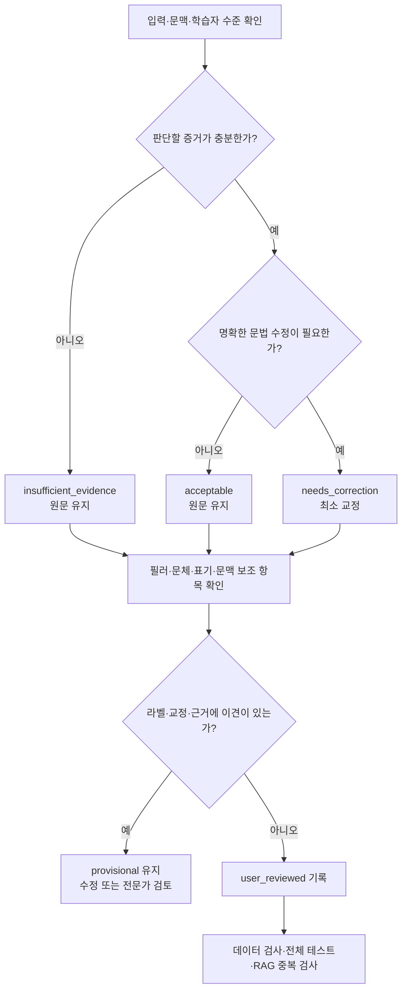

# 일본어 판단 평가셋 사람 검수 절차

기준일: 2026-09-04

대상은 `seed_v0.1.jsonl`의 합성 문항 72개다.
현재 72개 라벨은 익명 `user_reviewed`이며 검수일은 `2026-09-04`다. 일본어 전문가 검수는 아직 아니며 자동 테스트 통과가 문법 정답을 보증하지 않는다.

## 1. 검수의 목적

사람 검수는 다음을 확인한다.

- 문법 판단이 `acceptable / needs_correction / insufficient_evidence` 중 적절한가
- 교정이 원래 의미와 말투를 보존하면서 필요한 부분만 바꾸는가
- 여러 오류가 있는 문장에서 오류를 누락하지 않았는가
- 필러·회화체·문체 전환·표기 후보·동문서답을 문법 오류와 혼동하지 않았는가
- 학습자의 오류와 STT 오류를 근거 없이 단정하지 않았는가
- 한국어 근거가 짧고 정확하며 학습자를 부당하게 비난하지 않는가

## 2. 전체 흐름



## 3. 검수에 사용하는 파일

- 정답 원본: `seed_v0.1.jsonl`
- 사람이 읽는 표: `REVIEW.md`
- 판단·출력 규격: `README.md`
- 필러·문체·전사·문맥 세부 기준: `BOUNDARY_GUIDELINES.md`

`REVIEW.md`는 원본에서 생성되는 보기다. 직접 수정하지 않는다.
라벨이나 문항을 고칠 때에는 JSONL 원본을 수정하고 검수표를 다시 동기화한다.

## 4. 문항마다 확인할 항목

### 입력과 문맥

- `text`만 보지 않고 `context`와 `learner_level`을 함께 확인한다.
- 문맥이 제공되지 않았다면 화자의 의도나 질문과의 관련성을 추측하지 않는다.
- 합성된 녹음 중단·잡음 시나리오를 실제 음성 확인 결과로 오해하지 않는다.

### 문법 판단

- `acceptable`: 주어진 텍스트의 문법 구조를 수정할 필요가 없다.
- `needs_correction`: 근거가 명확한 문법 오류가 있다.
- `insufficient_evidence`: 전사 누락·녹음 중단·범위 밖 입력 등으로 판단할 수 없다.

`acceptable`은 표기, 발음, 문체, 문맥 적합성까지 모두 정상이라는 의미가 아니다.
정상적인 판단 보류는 시스템 호출·JSON 파싱 실패와 구분한다.

### 교정문과 오류 위치

- 의미·시제·긍정/부정·말투·필러를 보존하는가
- 필요한 범위만 수정하는가
- `source`, `replacement`, `[start, end)`가 원문과 일치하는가
- 여러 오류가 있을 때 모든 명확한 오류를 기록했는가
- 모든 edit를 적용하면 `corrected_text`와 정확히 같아지는가

### 허용 교정 후보

- 목적지의 `に/へ`처럼 둘 이상 허용되는 후보가 있는지 확인한다.
- `accepted_corrections`는 가능한 모든 정답을 열거한 목록이 아니다.
- 목록에 없다는 이유만으로 의미가 같은 올바른 교정을 자동 오답 처리하지 않는다.

### 보조 검수 항목

- 필러를 유지해야 하는가
- 문체 문제가 문법 오류가 아니라 별도 개선 제안인가
- 표기 정규화 후보가 있는가
- 학습자와 STT 중 오류 원인을 확인할 수 있는가
- 질문과 응답의 내용이 맞는가

보조 `check:` 태그는 정답 메타데이터이며 현재 모델 출력 필드가 아니다.

### 설명 품질

- `reason_ko`가 판단과 교정에 실제로 대응하는가
- 짧고 이해하기 쉬운가
- 확인되지 않은 발음, 의도, 능력 수준이나 오류 원인을 단정하지 않는가

## 5. 검수 결과 기록 방법

검토자는 각 문항에 다음 중 하나로 의견을 남긴다.

```text
JG-061 승인
JG-062 수정: 교정문은 ○○가 적절함
JG-063 보류: なんか의 기능을 추가 확인해야 함
JG-064 제외: 문맥이 지나치게 인위적이므로 대체 필요
```

- **승인:** 문항을 `user_reviewed`로 변경하고 날짜를 기록한다. 개인 검수자 식별자는 저장하지 않는다.
- **수정:** 문항을 고친 뒤 다시 보여주고 재확인한다. 재확인 전에는 `provisional`을 유지한다.
- **보류:** 이견을 기록하고 `provisional`을 유지한다. 필요한 경우 일본어 전문가에게 전달한다.
- **제외:** 삭제 또는 대체 문항을 작성하고 이유를 Git 이력에 남긴다.

검수 메타데이터 예시:

```json
"review": {
  "status": "user_reviewed",
  "reviewed_at": "2026-09-04"
}
```

실제 일본어 전문가가 확인하지 않은 문항을 `expert_reviewed`로 표시하지 않는다.
모델 간 합의나 자동 검사 통과를 사람 검수로 대체하지 않는다.

## 6. 권장 검수 순서

1. 경계 사례 12개를 세 문항씩 검수한다.
   - `JG-061`–`063`: 필러와 의미 있는 `なんか`
   - `JG-064`–`066`: 문체 혼용과 종속절
   - `JG-067`–`069`: 표기 후보, STT, 오류 원인
   - `JG-070`–`072`: 질문 관련성과 문법 오류의 공존
2. 기존 60개를 10개 단위로 검수한다.
3. 이견 문항만 다시 모아 2차 검수한다.
4. 위험도가 높은 문항을 일본어 전문가에게 전달한다.

최종 성능을 주장하려면 전체 문항의 전문가 검수가 가장 안전하다.
자원이 제한되면 최소한 모든 `needs_correction`, 모든 `boundary_case`, 복수 정답 사례와 정상 문장 표본을 전문가에게 검토받고 결과를 검수 등급별로 따로 보고한다.

## 7. 검수 완료 후 허용되는 범위

익명 사용자 검수가 끝났으므로 다음 작업을 진행할 수 있다.

- 검수본 버전과 SHA-256 고정
- 정답을 노출하지 않는 독립 모델 실행기와 결과 저장 형식 구현
- 베이스 모델 다운로드·로딩과 JSON 출력 smoke test
- 동일 조건의 0.8B·2B·4B 기본 모델 비교

다만 현재 자료는 72개의 소규모 합성 진단셋이며 전문가 인증본이 아니다. 다음 제한은 계속 적용한다.

- 이 점수만으로 운영 적합성이나 일본어 교육 품질을 인증하지 않는다.
- 평가 문항을 학습 데이터, few-shot 예문 또는 RAG 문서로 사용하지 않는다.
- 시험지를 보며 프롬프트나 모델을 반복 조정한 뒤 같은 점수를 최종 성능으로 발표하지 않는다.
- 최종 성능 주장을 위해서는 별도의 미사용 시험지와 가능한 범위의 전문가 검수를 확보한다.

## 8. 현재 출력 계약의 한계

현재 모델 출력은 문법 판단 네 필드만 요구한다.

- `decision`
- `corrected_text`
- `edits`
- `reason_ko`

따라서 현재 구조는 문체 개선 필요성, 표기 정규화 후보, 동문서답 탐지를 정형 지표로 직접 측정하지 못한다.
경계 문항은 우선 이러한 요소 때문에 문법을 과교정하지 않는지 확인하는 용도다.

첫 문법 판단모델을 비교한 뒤 제품에서 별도 알림이 필요하다고 결정하면 `advisories` 같은 분리된 출력 배열을 설계한다.
문법 상태를 무리하게 네 번째 단일 상태로 확장하지 않는다. 문법 오류와 문맥 불일치는 동시에 발생할 수 있기 때문이다.

## 9. 검수 완료 조건

- 72개 모두 승인·수정·보류·제외 중 하나로 처리됐다.
- 승인 문항은 `user_reviewed` 이상으로 기록됐다.
- 수정 문항은 재검수를 마쳤다.
- 보류 문항과 전문가 검토 대상이 명시됐다.
- 데이터 구조, 오류 위치, 교정문 복원 검사를 통과했다.
- 전체 회귀 테스트를 통과했다.
- RAG 직접 중복 검사를 다시 수행했다.
- 데이터 버전과 SHA-256을 기록했다.
- 고정한 시험지를 학습·few-shot·RAG에 사용하지 않는다는 원칙을 확인했다.

모든 문항이 `provisional`이 아니어야 하는 최종 확인에는 다음 명령을 사용한다.

```bash
venv/bin/python -B -m evaluation.judgment.dataset --require-reviewed
```

현재는 72문항의 익명 사용자 검수가 완료됐으므로 이 명령이 성공해야 한다.
